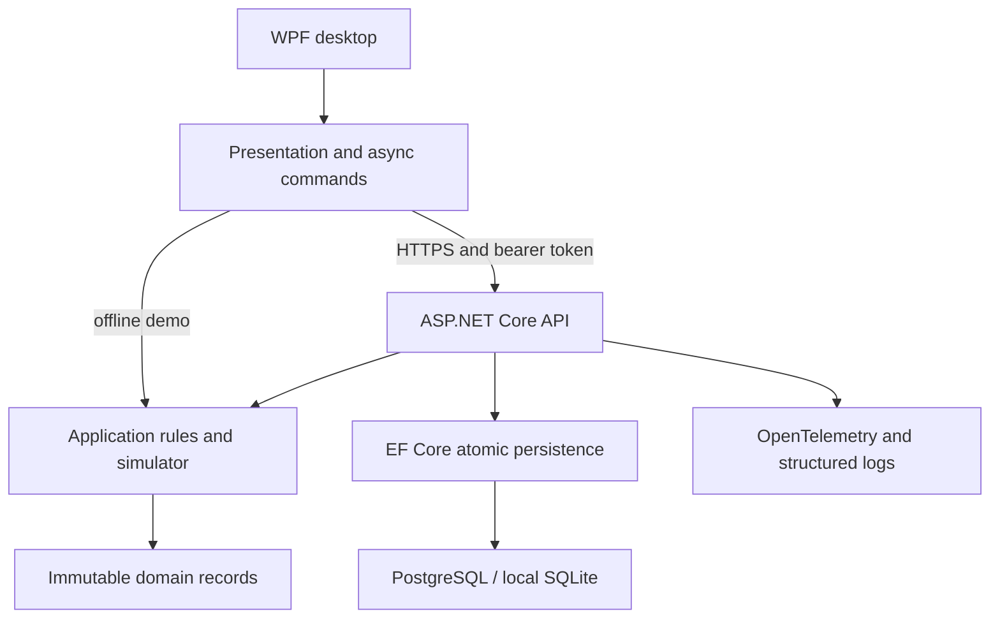

# Teammy Commissioning Studio

**A .NET 10 engineering workbench for taking a drive configuration from team workboard to tested, independently approved release.**

Teammy combines a native WPF desktop, a deterministic drive simulator, and a deployable ASP.NET Core service. It evolves the original DevTeammy team/project/task planner into a focused industrial-software showcase: engineers coordinate commissioning work, validate settings, inspect telemetry, and capture review decisions with an atomic audit trail.

The workspace contains a **synthetic reference lab**. Its drive model is a software simulation; it does not connect to or control physical equipment.

## What you can do

- Manage work across two engineering projects with assignments, priorities, due dates, and guarded status transitions.
- Edit drive speed, acceleration/deceleration, current limit, and simulated load against explicit device-profile limits.
- Run repeatable simulation checks and inspect speed/current/temperature telemetry.
- Request a release only when blocking work is complete and every configuration has current passing evidence.
- Review as a separate approver. The requester and configuration authors cannot approve their own candidate; subsequent changes invalidate a pending candidate.
- Inspect who changed what and at which revision. Concurrent writes return a conflict instead of silently overwriting another engineer's work.

## Try the desktop

The Windows CI job publishes a self-contained x64 build of the desktop as an artifact; extract the entire folder and launch `Teammy.Desktop.exe`.

Requirements: Windows and the [.NET 10 SDK](https://dotnet.microsoft.com/en-us/download/dotnet/10.0), matching `global.json`. The self-contained package produced by Windows CI does not require a separately installed runtime.

```powershell
dotnet restore Teammy.sln --locked-mode
dotnet run --project src/Teammy.Desktop -- --demo
```

The default launch is an in-memory local demo. It starts without a database, cloud account, network connection, or sign-in. Its role selector is explicitly a demo control and its changes last until the application closes.

### A five-minute walkthrough

1. Explore **Packaging line commissioning**, its workboard, drive settings, and evidence. Its unfinished high-priority work illustrates why a release is blocked.
2. Select **Cooling loop upgrade**, which begins with passing evidence and completed blocking work.
3. As the engineer, request a release with review notes.
4. Switch the local demo actor to the approver and approve the candidate. Inspect the corresponding audit records.
5. Return to the engineer, modify a drive configuration, and rerun the simulation. Earlier evidence belongs to the earlier configuration revision.

The sample data is intentionally small enough to understand in one review. There is one shared lab workspace; registered members can read the workspace, while mutation permissions also enforce project-team membership. This is not a multi-tenant service.

## Run the service

### SQLite development host

```bash
dotnet run --project src/Teammy.Api --launch-profile Demo
```

The `Demo` launch profile explicitly enables development-only demo authentication, applies the local SQLite migrations, and initializes the reference lab. The database persists across restarts.

```bash
curl -H 'X-Teammy-Demo-Role: Viewer' http://localhost:5080/api/workspace
python3 scripts/smoke-api.py --base-url http://localhost:5080 --demo
```

Connect the Windows desktop to this persisted development service:

```powershell
dotnet run --project src/Teammy.Desktop -- --api-demo http://localhost:5080
```

### PostgreSQL and containers

Requirements: Docker with Compose v2 and Python 3.

```bash
bash scripts/dev-up.sh
docker compose logs -f api
docker compose down
```

The startup script generates a private local database password, builds the nonroot API image, waits for PostgreSQL, runs the separate migration job, and checks real HTTP behavior. Only the API's loopback port is exposed. A named database volume survives `docker compose down`; adding `--volumes` deletes that local data.

### Authenticated hosted mode

```powershell
# Set TEAMMY_API_TOKEN to a short-lived access token obtained from your configured issuer.
# Keep the token out of scripts, shell history, and source control.
dotnet run --project src/Teammy.Desktop -- --api https://your-configured-api.example
```

The API validates the token's signature, issuer, audience, expiry, mapped subject, and role. The desktop obtains its actor from `/api/me`, and retains the supplied token only in process memory. An interactive identity-provider sign-in UI is outside this implementation. Deployment configuration and the three reference-lab subject mappings are documented in [deployment.md](docs/deployment.md).

## Architecture



| Project | Responsibility |
| --- | --- |
| `Teammy.Domain` | Immutable state, typed roles/statuses, configuration and evidence records |
| `Teammy.Application` | Pure command engine, release rules, deterministic drive model, reference seed |
| `Teammy.Presentation` | Testable MVVM state, async commands, HTTP/offline client adapters |
| `Teammy.Desktop` | Native XAML views, styles, telemetry drawing, composition and Windows smoke renderer |
| `Teammy.Infrastructure` | Provider-specific migrations, compare-and-swap persistence, atomic audit append, runtime database role provisioning |
| `Teammy.Api` | JWT boundary, identity mapping, validation/errors, health, rate limiting, tracing and metrics |

The shared rules remain independent of WPF, HTTP, and the database. The API owns authentication and persistence. The desktop has no database connection string. [Architecture and tradeoffs](docs/architecture.md) explain the aggregate boundary, revision model, and extension points.

## Verify it

```bash
# Linux/macOS: application, presentation, API and infrastructure tests
bash scripts/verify.sh
```

```powershell
# Windows: full solution including XAML, plus the shared test suites
./scripts/verify.ps1 -Desktop
```

The verification scripts enforce locked dependencies, formatting, analyzer-clean release builds, tests, an 80% shared-rules line-coverage floor, and a direct/transitive NuGet vulnerability audit. PostgreSQL-specific tests additionally run when `TEAMMY_TEST_POSTGRES` points to a **disposable test database**; runtime-role permission tests require `TEAMMY_TEST_PROVISION_ROLE=1`. CI provides both explicitly.

The [Verify workflow](.github/workflows/ci.yml) adds:

- Linux tests against SQLite and PostgreSQL 17, plus live HTTP smoke checks.
- Windows build, standalone `win-x64` publish, actual WPF launch/render, and screenshot artifacts.
- Terraform provider-lock validation for both infrastructure stacks.
- Current-tree secret/dependency scanning, runtime-container vulnerability scanning, and a CycloneDX SBOM.

All third-party actions and base container images are pinned to verified commits/digests. Dependabot proposes updates. The Windows package is **unsigned** unless a trusted signing process is added; no signing identity is fabricated. See [verification.md](docs/verification.md) for executed evidence and environment-specific checks.

## Deploy and operate

The Azure path uses Container Apps, private PostgreSQL, separate migration/runtime identities and database permissions, Key Vault references, and an Azure Container Registry with its admin account disabled. Infrastructure is split into platform and service states so schema initialization can complete before the first API revision starts.

The manual [Deploy to Azure workflow](.github/workflows/deploy.yml) reruns verification, authenticates through GitHub OIDC, publishes an immutable image with provenance/SBOM, scans that exact image, runs migrations, verifies an isolated candidate revision, moves traffic, and restores the previous revision if rollout checks fail. Protect its `production` environment with required reviewers and a branch policy.

- [Deployment and identity setup](docs/deployment.md)
- [Operations, rollback, backups and observability](docs/operations.md)
- [Security model and historical credential response](SECURITY.md)

Cloud deployment is opt-in and creates billable resources. The default database size and single-zone configuration suit a small showcase; select the documented HA settings and validate capacity before making an availability commitment.

## Project lineage

This rebuild starts from [COMP231-001-Team-3/DevTeammy](https://github.com/COMP231-001-Team-3/DevTeammy), baseline commit `b829f88`. The original team's WPF planner supplies the product idea; the current implementation, domain boundaries, persistence, authentication, simulator, tests and delivery pipeline are rebuilt. The original history preserves provenance. Obsolete package trees, migration backups, binaries, installer certificates and credential-bearing source are removed from the active tree. Historical credentials require revocation as described in [SECURITY.md](SECURITY.md).

No new license has been asserted over the original project.
